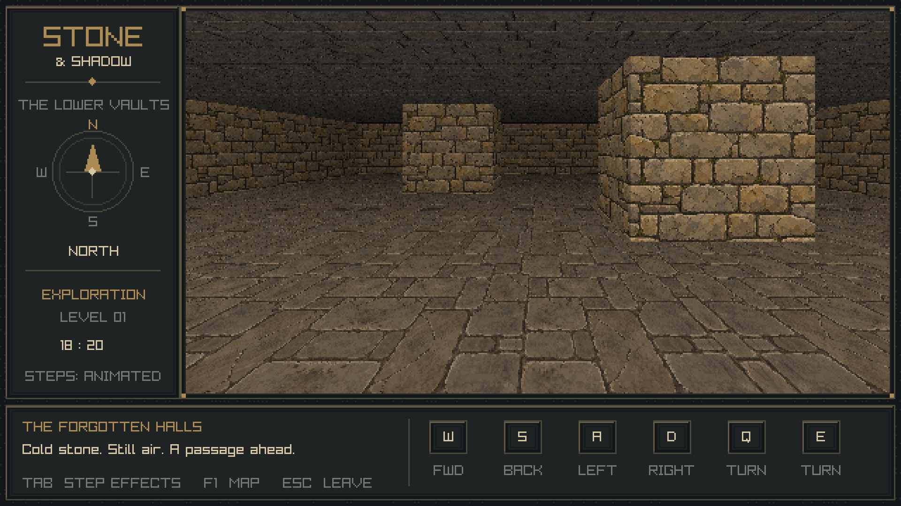
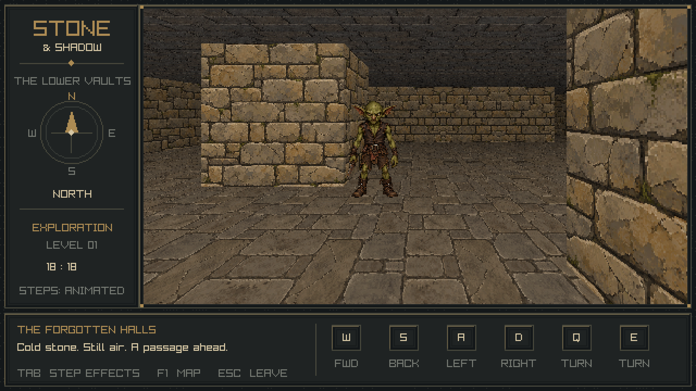

# Stone & Shadow

A C++17 / raylib 6.2 prototype of a 1990s grid-based dungeon crawler. Rendering,
six-direction keyboard movement, wall/NPC collision, and a small exploration level
with animated goblins, a four-character party HUD, and hybrid ranged approach / turn-based combat with spells and class abilities.



## Build and run

Requirements: a C++17 compiler, CMake 3.24+, Ninja, and desktop OpenGL 3.3 support.
CMake first looks for an installed raylib **6.2** package. If absent, it downloads
the pinned release through FetchContent and verifies its SHA-256. Subsequent
builds can run offline. Set `BLOBBER_USE_SYSTEM_RAYLIB=OFF` to force the pinned fallback.
NPC JSON uses **nlohmann/json 3.12.0** with the same installed-package preference
and a SHA-256-pinned download fallback (`BLOBBER_USE_SYSTEM_JSON=OFF` forces it).

```sh
cmake --preset debug
cmake --build --preset debug
ctest --preset debug
./cmake-build-debug/blobber
```

For optimization, substitute `release` for `debug` in all commands. To use a
different generator, configure normally, for example
`cmake -S . -B build -DCMAKE_BUILD_TYPE=Debug`, then `cmake --build build`.
Multi-configuration generators also work; select the desired configuration when
building and running tests.

On Debian/Ubuntu, the native build dependencies are typically:

```sh
sudo apt install build-essential cmake ninja-build libx11-dev libxrandr-dev \
    libxinerama-dev libxcursor-dev libxi-dev libgl1-mesa-dev
```

Audio is disabled. On Windows use a configured MSVC or MinGW toolchain; on macOS,
Xcode command-line tools plus CMake and Ninja. Linux/X11 is the verified platform.

### CLion

Open this directory or its `CMakeLists.txt`. Enable the `debug` or `release`
CMake preset, wait for configuration, select the **blobber** executable, and Run.
CLion's ordinary CMake profiles also work. No machine-specific `.idea` files or
working-directory setup is required: assets are copied beside the executable.

## Controls

| Key | Action |
| --- | --- |
| W / S | Forward / backward one tile |
| A / D | Strafe left / right one tile |
| Q / E | Turn left / right 90 degrees |
| Tab | Toggle animated / instant steps |
| F1 | Toggle the development map overlay |
| Monster hover / click | Preview reach and damage / immediately attack a reachable enemy |
| 1 / sword | Select basic melee |
| 2 / shield | Immediately defend |
| 3 / bow | Select ranged attack |
| 4 / spell | Browse paused Spells / Abilities, then resume to select targets |
| 5 / item | Reserved for the inventory slice |
| 6 / aid | Arm Aid; click a dying ally's portrait to commit |
| Portrait click | Select a character in real time, or a friendly spell/Aid target; use i for details |
| Spellbook Up / Down, Enter | Browse descriptions, then choose a spell or ability |
| Spell targeting Left / Right, Up, Enter | Move cursor, add/toggle recipient, then cast |
| Left / Right, Enter | Cycle targets, then execute; Enter also acknowledges outcomes |
| Escape / Backspace / right-click | Cancel targeting or close an overlay; unarmed Escape/Backspace opens pause menu |
| Mouse wheel over log / + | Scroll readable history / expand paused history |
| Gear | Open pause menu with Resume and Quit |

The first movement action occurs on keypress; holding a movement key repeats after 300 ms and then
every 180 ms. An animated action lasts 160 ms. At most one fresh keypress is
buffered during an animation. Losing focus clears the buffer and held-key state.
Collisions block the entire move, including its visual effect. HUD commands never
repeat while held. Controls held during focus loss require a release in the focused
window before their next press can act. Targets clear when movement starts or focus is lost; targeting
and attacks wait until transitions finish and the F1 map is closed. Each action/turn resets to basic melee.

Facing an adjacent goblin cell begins combat and locks movement/turning. Each
character and enemy group rolls initiative once; the initiative strip puts the active participant first and removes resolved turns. Melee, Defend and Aid spend one action. Defend imposes disadvantage until the
next turn; Aid attempts DC 10 Wisdom stabilization of another dying ally.

Front slots protect their paired rear slots on **both sides** (FL/BL and FR/BR).
A rear member can attack or be targeted as soon as its own front slot falls.
An exposed melee goblin moves into that vacant front slot on its next turn, then
attacks once. Party members retain their slots. Body visibility is also
required. Hover explains paired-slot protection and other reach restrictions. The Rogue can melee from behind an ally and gains conditional Sneak Attack; enemy
paired protection still applies. Inflict Wounds uses ordinary exposed melee reach.
Ranged attacks and spells ignore enemy row protection. Items remain deferred.

At zero HP, characters make death saves on their turns. Aid stabilizes without
healing. Victory stabilizes surviving downed allies and preserves HP/deaths;
Continue resumes exploration. No conscious party member means defeat; Restart
reconstructs the party and monsters. Map/log browsing and focus loss pause gameplay.
Cleric and Wizard start with four mana; first-level spells cost two and cantrips
cost none. Casting takes one action or the shared six-second cooldown in real time.
Mana and feature charges do not reset after encounters. Resting is a later slice;
Restart restores initial resources. Portrait selection is distinct from the active turn.

Slice 10 review: `./cmake-build-debug/blobber --spell-demo --seed 5` opens the
Wizard's spellbook on the hybrid demo map. Browsing pauses; selecting an entry
resumes play. Click a body/portrait for a single-target cast. Bless/Bane/Acid Splash
let you toggle multiple targets; Magic Missile begins with three darts on the first
target, and subsequent clicks move darts to other targets. Confirm with Cast/Enter.
Area spells preview the three clear front cells. Escape cancels without spending.
Fighter Second Wind and Wizard Arcane Recovery are in the same picker. A blue
portrait marker indicates concentration; inspect details for effects and use
End concentration in the picker to dismiss it freely. Rogue features are automatic.

`--capture-spells DIRECTORY` exports deterministic hidden-window spell/ability
captures. `blobber_spells_tests --trace` provides a headless impact/resource trace.
See [spell design](docs/spells_design.md) for the exact roster and adaptations.

For immediate review, run `./cmake-build-debug/blobber --combat-demo --seed 5`.
This starts beside the existing goblins using the production combat path. `--seed`
accepts an unsigned 32-bit integer; normal play reports its generated seed and
restart reuses it. See [current UI review](docs/dungeon_ui_verification.md) and [combat limitations](docs/slice05_verification.md).

Run `./cmake-build-debug/blobber --ui-demo` for eight deterministic development
scenarios near the goblins. F2/NEXT advances; F3/RESET resets the current scenario.
The banner identifies sample HP/mana/status values; they never change the real
party. Scenarios cover previews, unavailable actions, missing/removed targets,
low HP/unconscious/dead displays and log rollover. The regular `--capture` command
also exports eight `ui-*` images. See [slice 04 review](docs/slice04_verification.md).

The player starts at `(3, 21)`, facing north. The enclosed 25×25 test map contains
two large chambers, pillars, loops, dead ends, and long corridors. Press F1 to
inspect the layout. `assets/maze.txt` is plain ASCII: `#` is solid, `.` is floor.
All floor tiles must be reachable from the spawn.

## NPCs

The test goblins stand at **(18,17)** in the southeast great hall, facing south.
The player still starts at (3,21). Use F1 and the coordinate readout to navigate;
stand at (18,18) facing north to start a frontal fight. Contact turns the goblins
toward the party. Authored directional views remain in the capture diagnostics.
Living occupants block player entry into the entire cell.



Edit `assets/npcs/level.json` to list definition files and placements. Each
placement has a string `type`, integer `cell: [x,y]`, `subcell: [x,y]` with each
component 0 or 1, and `facing: "north"`, `"east"`, `"south"`, or `"west"`.
The four subcells are world-aligned quarter/three-quarter positions; at most one
NPC occupies each slot. All current runtime placements are hostile; friendly
NPC behavior is not implemented.

A definition such as `assets/npcs/goblin/goblin.json` contains `id`, `width`,
`height` (full canvas dimensions in cell units), and four `views` named `front`,
`back`, `left`, `right`. Left/right refer to the NPC's anatomical sides. Each view
is a PNG path or `{ "image": "front.png", "anchor": [0.5, 1.0] }`; anchors are
normalized foot positions, defaulting to bottom center. Paths are relative to
the JSON that declares them. An optional `alpha_cutoff` (default 0) removes pixels
at or below that alpha during preparation. Source PNGs remain unchanged.

Rebuild to copy edited assets beside the executable. Custom `--assets` directories
must include `npcs/level.json`; use `{ "definitions": [], "instances": [] }` for
an empty level. Invalid placements, unknown types, malformed assets, and exceeded
limits fail at startup with an error. See the [NPC design](docs/npc_design.md) for
ownership, limits, and future extension points. Animated definitions use `animations`
instead of `views`; each clip has `durations_ms` and directional frame arrays.
Optional clip `width` overrides canvas width (death may be up to one cell wide).
Hurt/death clips are triggered, never placement loops. Runtime actors have HP,
live occupancy, checked movement/removal and damage/death reactions. Production actors idle while stationary combat resolves independently;
authored walk/attack loops remain isolated showcases. Production enemy attacks play
the existing attack clip once on hits and misses. Red damage splats and white MISS
splats briefly mark the affected monster or party portrait. Autonomous cross-cell
movement and runtime spawning remain deferred. Goblins flinch for 300 ms on damage;
lethal damage immediately releases collision, plays a 600 ms collapse, holds a
corpse for 600 ms, then hides. Both reactions retain the first 100 ms white flash.
All four hurt/death directions are authored; existing attacks remain front-only.
See [slice 06 review and captures](docs/slice06_verification.md).

## Rendering

This is a **2D image compositor**. At startup it prepares perspective wall sprites
for fixed cardinal headings, covering twelve tiles of depth and eight lateral
fractions of a tile. Each fraction has sixteen floor/ceiling backgrounds (four
headings × four world X/Y parity combinations). It then selects and layers
those sprites for the current view. Each prepared sprite stores cropped vertical
pixel strips and their depth; a column coverage buffer resolves occlusion at
corners and pillars. Equal-height walls make this coverage representation exact.
NPCs use pre-scaled, shaded alpha images at the same subcell depths and strafe
phases. They are blended far-to-near and clipped against wall column depths,
including partial pillar occlusion. Soft semitransparent contact shadows are
prepared as floor-projected blobs and blended beneath the bodies. The runtime
scene compositor uses neither
ray traversal nor a 3D camera/mesh.

The prepared projection uses a 90° horizontal field of view and a viewpoint 0.4
tiles behind the player's tile center, still inside that tile. This exposes side
passages while standing beside them and keeps an adjacent wall far enough away
to leave foreground floor visible. The horizon is 36% down the viewport, giving
more space to the floor. This is an off-center projection, keeping vertical walls
upright rather than pitching them. `ViewProjection` in `src/render/projection.hpp` holds
these settings; wall sprites, floor/ceiling sampling, and movement effects share
them. The player remains at the tile center for movement and collision.

The textures are original imagegen artwork, normalized to 256×256 PNGs with
nearest-neighbor sampling. Mirrored tile addressing joins texture edges.
Side faces, ceilings, distance shading, and a twelve-tile fade give depth cues.
Floor, ceiling, and wall texture parity is anchored to the map so materials remain
attached to their surfaces throughout a side step and at its endpoint.

Grid moves and headings remain discrete. Forward/back movement uses short
image-space zoom/inset effects; Q/E turns use stretched strips. A/D strafes use
the prepared fractional views at the same heading: nearby objects move farther
than distant walls, the horizon stays fixed, and newly revealed surfaces are
composed with proper occlusion. Left strafes reuse the same eight-step cache in
reverse. The game still draws 2D images; no runtime 3D scene or raycaster is used.
Tab switches transitions off.

The full presentation uses a 640×360 pixel-art grid. The viewport is 500×282 at
`(4, 18)`, with four portraits on the right and a 54-pixel (15%) action/log dock below. That composition
is enlarged exactly 3× into a **1920×1080 render texture**. Finally that texture
is fitted to the actual framebuffer, centered with black bars and point filtering.
A separate transparent 1920×1080 text layer uses bilinear filtering during that
final fit, preserving thin font strokes in smaller windows without softening art.
HUD text is drawn directly onto its 1920×1080 text target using the supplied fonts:
DejaVu Serif Bold for headings/names, IBM Plex Sans for controls/labels, and Inconsolata for the log. Each face/size has
its own atlas (21/24/27 px), used at its exact raster size with rounded positions.
`assets/fonts` and `assets/ui` are copied beside the executable and are required for custom assets.
Eleven generated UI images are prepared into one reusable 256×192 atlas at startup.
Their exact built-in imagegen prompts are in `assets/ui/prompts.json`; font licenses
are alongside the bundled fonts.
Window resizing never changes the logical resolution, perspective, or UI layout.
At noninteger scales, pixel widths necessarily vary slightly to fill the fitted area.

## Assets and screenshots

Keep disposable generation experiments, unselected sheets, and intermediate
files in `/tmp` outside the repository or in the ignored repository directories
`tmp/`, `temp/`, `scratch/`, or `output/`. Asset-local directories named `tmp`,
`temp`, or `scratch` are also ignored. Use `captures/` or `captures-*/` for
disposable diagnostic captures.

Selected source artwork, animation sheets, runtime textures/frames, manifests,
prompts, and curated previews in `docs/screenshots/` are intentional versioned
assets, even when generated by a tool. Do not put them in the scratch directories.

The three original images are in `assets/originals/`; the runtime textures are in
`assets/textures/`. Each exact generation prompt is saved as
`assets/{wall,floor,ceiling}-prompt.txt`. All three were made using the built-in
imagegen tool; no original game artwork is included. The four goblin views were
also generated with the built-in imagegen tool. Selected PNGs are in
`assets/npcs/goblin/` (`front.png`, `back-v2.png`, `left.png`, `right.png`), alongside
the exact prompt history in `prompts.txt` and an unused first back-view variant.

To repeat the deterministic normalization of the generated originals:

```sh
cmake --build --preset debug --target blobber_prepare_assets
./cmake-build-debug/blobber_prepare_assets assets/originals assets/textures
cmake --build --preset debug
```

The developer capture mode preserves existing dungeon, transition, NPC, actor and
UI diagnostic filenames and adds combat and four-direction reaction cases for the shipped level.
It also exports focused `hud-*` cases at native, 1280×720, and letterboxed
1024×768 sizes, then exits. Capture mode uses a hidden window and exports its own
render targets; it never captures another window or injects desktop input:

```sh
./cmake-build-debug/blobber --capture /tmp/blobber-captures
# Focused UI captures only:
./cmake-build-debug/blobber --capture-hud /tmp/blobber-ui
# Focused hurt/death poses, transitions, corpse replacement and combat outcomes:
./cmake-build-debug/blobber --capture-reactions /tmp/blobber-reactions
```

`--assets DIRECTORY` overrides the default executable-relative asset directory.
Missing assets or malformed maps produce a clear error and a nonzero exit status.
Representative verified screenshots are included in `docs/screenshots/`.

## Code and checks

The [system design](docs/system_design.md) describes module boundaries, ownership,
capacities, and extension points. The project is organized into world, movement,
input timing, assets, CPU rendering, UI, platform, and application modules.
`main.cpp` only calls the application and reports errors.

The CPU frame path reuses three fixed-size buffers. Prepared wall data uses
contiguous column/pixel arrays, and unchanged views skip viewport uploads.
GPU textures and render targets are owned by bounded registries with typed,
generation-checked handles and RAII cleanup before the window closes.

Seventeen routine CTest suites cover rules/health/party/actors/combat, commands and input, picking,
core behavior, rendering against an independent geometric oracle, resource
lifetime/loading failures, NPC loading/rendering/collision, and zero C++ allocations
in engine-owned CPU frame processing. They own their fixtures and need no display.
Loading, preparation, diagnostic exports, and raylib/driver internals are outside
the allocation guarantee. No performance benchmark framework is required.

The separate GPU lifecycle check needs a display and uses a hidden window:

```sh
cmake --build --preset debug --target blobber_gpu_smoke
./cmake-build-debug/blobber_gpu_smoke
```

C++ formatting is defined by `.clang-format`. See [research notes](docs/research.md)
for historical sources and [verification notes](docs/verification.md) for checks
and remaining platform limitations.

The prototype has no moving NPC AI, ranged/spell combat, inventory, interactive doors, audio,
save system, or procedural level generation. Walls have one uniform height;
transparent walls and variable elevations would require a richer coverage model.
