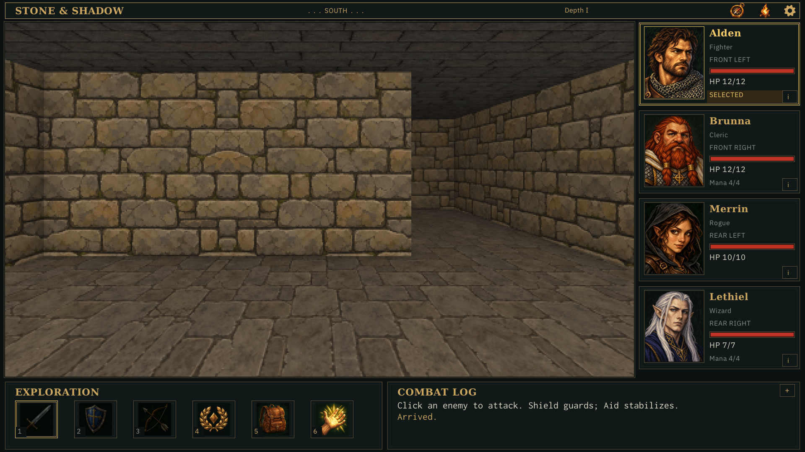

# Stone & Shadow

Stone & Shadow is an old-school, party-based dungeon crawler built with C++17 and
[raylib](https://www.raylib.com/). Lead four adventurers from the sanctuary town
into procedurally generated dungeons, gather loot, and bring the party home alive.

- Grid-based exploration with a first-person view and turn-based combat.
- A four-character party with spells, class abilities, and equipment to manage.
- A sanctuary hub with merchants, an inn, and a place to prepare for expeditions.
- Campaign saves and Continue, plus an arena mode for combat encounters.



## Download and play

Prebuilt **Windows x64** and **Linux x86-64** builds are available from
[Desktop distribution builds](https://github.com/biscon/blobber/actions/workflows/windows-review.yml):

1. Open the latest successful build run.
2. Scroll to **Artifacts** and download the archive for your platform:

   | Platform | Download | Requirements |
   | --- | --- | --- |
   | Windows | `blobber-VERSION-windows-x86_64.zip` | Windows 11 x64 and OpenGL 3.3 |
   | Linux | `blobber-VERSION-linux-x86_64.tar.gz` | glibc 2.35+, X11 or XWayland, and OpenGL 3.3 |

3. Extract the complete archive into a folder.
4. On Windows, launch **blobber.exe**. On Linux, run **./blobber** from the extracted
   folder.

Keep the `assets` and `notices` folders beside the executable. Choose **New Campaign**
to begin, or **Continue** to resume an expedition. No compiler or administrator
installation is needed to play a downloaded build.

GitHub requires sign-in to download Actions artifacts, which are kept for seven
days. There are no tagged releases yet; published versions will appear on the
[Releases page](https://github.com/biscon/blobber/releases). Optional `.sha256`
downloads let you check archive integrity.

## Build from source

You will need:

- Git and a C++17 compiler.
- CMake **3.24 or newer** and Ninja.
- Python 3 for the development/test configuration.
- Desktop OpenGL 3.3 support.

CMake downloads raylib, nlohmann/json, and yaml-cpp when suitable installed versions
are unavailable, so the initial configuration needs an internet connection. The
first build also prepares the game assets and takes longer than later builds.

### Linux

On Debian or Ubuntu, install the native build dependencies:

```sh
sudo apt install build-essential git cmake ninja-build python3 \
    libx11-dev libxrandr-dev libxinerama-dev libxcursor-dev libxi-dev \
    libgl1-mesa-dev
```

Make sure `cmake --version` reports 3.24 or newer. If your distribution supplies an
older version, use a newer CMake release or the one bundled with your IDE.

Clone, build, and run:

```sh
git clone https://github.com/biscon/blobber.git
cd blobber
cmake --preset release
cmake --build --preset release --target blobber
./cmake-build-release/blobber
```

### Windows

Install Visual Studio 2022 or Build Tools for Visual Studio with **Desktop
development with C++** and a Windows SDK, plus Git, CMake, Ninja, and Python 3.
Use an **x64 Native Tools Command Prompt for VS 2022**, then run:

```bat
git clone https://github.com/biscon/blobber.git
cd blobber
cmake --preset release
cmake --build --preset release --target blobber
cmake-build-release\blobber.exe
```

### Debug builds and CLion

For a Debug build, replace `release` with `debug` in the commands and executable
path above.

In CLion, open the project directory or `CMakeLists.txt`, enable the `debug` or
`release` preset, select the **blobber** target, and build/run it. Keep using the
same CMake and build tools for an existing build folder.

### Tests

To build and run the development tests:

```sh
cmake --preset debug
cmake --build --preset debug
ctest --preset debug
```

## Controls

| Control | Action |
| --- | --- |
| W / S | Move forward / backward |
| A / D | Strafe left / right |
| Q / E | Turn left / right |
| F | Interact with a nearby door, key, or stair |
| M | Open the discovered map |
| T | Open Travel |
| I | Open Inventory / Character |
| R | Open camp and rest options |
| 1–6 | Combat and quick actions |
| Escape / Backspace | Pause, cancel an action, or close a panel |

Use the mouse to select party members, interact with characters, attack enemies,
and collect loot. Drag items to move or equip them; Shift-drag splits a stack.
The opening welcome screen introduces the controls and sanctuary.

## Saved games

Saved games and characters live outside the installation folder:

- **Windows:** `%LOCALAPPDATA%\blobber\`
- **Linux:** `~/.local/share/blobber/`, with settings in `~/.config/blobber/`
  (or your configured XDG locations).

Keep these files when upgrading. Save compatibility depends on the game's content
and save format, so keep an older package if you want to return to its saves.

## Credits

Built with raylib, nlohmann/json, and yaml-cpp. Dependency and asset notices are
included with the downloads; see the [third-party notice information](packaging/notices/README.md)
for details.
