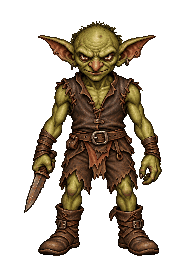
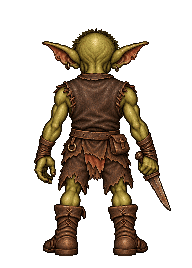
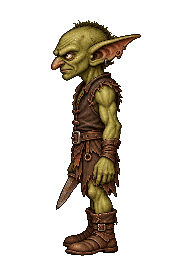
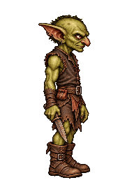
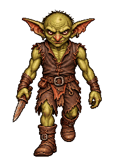
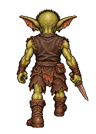
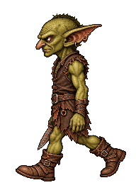
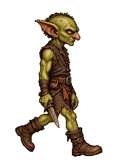
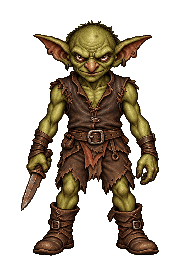

# NPC sprites

Slice 06 is implemented, awaiting user review: [hurt/death design](goblin_reactions_design.md)
and [verification](slice06_verification.md). The foundation below incorporates its
current contracts; historical slice 05 notes are marked separately.

Status: implemented. See [verification notes](verification.md#npc-first-slice) for executed checks.

## Ownership and data

The loader produces immutable `NpcWorld` placement data and the renderer owns its
prepared sprite cache. Slice 03 adds [runtime actors](actors_design.md), owned by
the application and initialized from placements; their state and occupancy are
the live authority. CPU source images are released after
preparation. Core NPC instances contain a typed definition index, cell, 2x2
subcell, cardinal facing, selected animation, and phase offset. The world owns the definition string IDs; appearance
arrays use the same index order. Indices never recycle in this slice; checked
access rejects invalid indices. There is no ECS, AI, faction system or general-purpose animation scheduler.
Monster HP and checked lifecycle operations now belong to the actor owner.
A bounded graphics-independent animation player supplies frame selections.

`assets/npcs/level.json` lists definition JSON paths and placements. Definition
paths are relative to the level file; PNG paths are relative to their definition.
Definitions contain `id`, `width`, `height`, and `views` with `front`, `back`,
`left`, `right` PNG names (either strings or objects containing `image` and
optional `anchor`). Instances contain `type`, `cell`, `subcell`, and
`facing` (`north`, `east`, `south`, `west`). Left/right name anatomical sides.
Optional per-view normalized `anchor` coordinates permit exact foot alignment
without modifying generated artwork; the default is bottom center. Width and
height describe the full image canvas in cell units. All four views share these
dimensions; narrower side profiles keep their transparent horizontal padding.
Images preserve alpha except values at or below the optional `alpha_cutoff`
(0..254, default 0), which are transparent during preparation. The goblin uses
15 to discard nearly invisible generated background noise. Visible pixels below
the ground anchor are rejected. `validateNpcAppearance` is shared by the file
loader and the preparer so generated assets obey the same invariants.

Subcell [0,0] is northwest, [1,1] southeast; world positions are cell origin plus
0.25 or 0.75 on each axis. A row-major byte occupancy mask validates loaded placements. The runtime actor
owner maintains its own authoritative mask for constant-time whole-cell movement
collision and atomic subslot updates. The map is unchanged. NPC placement rejects walls,
player spawn, duplicate subcells, bad definitions and invalid coordinates.

Limits: 32 definitions, 256 instances, 4 occupants per cell, 2048 pixels per image
axis, 128 MiB combined engine-owned decoded/prepared pixel arrays. Temporary
Raylib decoder storage and container metadata are outside that pixel budget.
JSON files are bounded to 1 MiB. Living sprite canvas widths are at most 0.5 cells; a death clip can override width
up to 1 cell. Heights remain at most wall height.
All limits fail explicitly during loading. All vectors allocate only during
loading/preparation. The frame path uses fixed scratch arrays. Replacing level assets requires reconstructing their renderer/pipeline. Runtime
actor mutation reuses the same prepared assets; it does not rebake images.

## Rendering

Contact shadows are prepared circular floor blobs, with radius 45% of the sprite
canvas width, peak opacity 32%, and a smooth quadratic falloff. Projected floor
rows and alpha bytes are cached at load time, shared across directions and
instances. Alpha storage counts against the existing pixel budget; row metadata
is bounded by types x depth slots x viewport height. Each row retains its floor
depth, so lateral placement follows perspective during strafes and wall depth
clips shadows without painting walls. Distance fog fades the blobs out. All
shadows draw before all NPC bodies, preventing shadows from darkening other NPCs.
No new asset or frame allocation is needed. Tests cover floor placement,
transparency, partial/full wall clipping, multiple occupants, and the existing
allocation and strafe invariants.

For each type/clip/direction/frame prepare nearest-neighbor scaled and distance-shaded RGBA
images for integer forward rows 0..12 and subcell depth offsets -0.25/+0.25,
including the existing 0.4 camera setback. Depth determines size and ground
projection; lateral position and strafe phase only change horizontal placement.
Clip preparation vertically to the viewport and retain the original horizontal
pivot. The cache uses contiguous pixels and immutable offsets, shared across
instances and lateral positions. The cache budget includes input image pixels.

During composition build a fixed-size visible list, sort far-to-near (instance
index breaks ties), and alpha blend after walls. Wall column depth rejects NPC
columns behind walls. NPCs never update wall coverage: their transparent holes
must expose farther NPCs and scenery. Grounded sprites no taller than walls make
the existing one-depth-per-column wall representation sufficient. Use the same
distance lighting/fog as wall front faces, preserving source alpha.

View selection uses the NPC-to-effective-camera vector relative to NPC facing;
dominant local axis chooses front/back/left/right, with front/back winning exact
diagonal ties. Effective camera includes setback and quantized strafe offset.
Forward/back/turn transitions continue operating on complete prepared frames.
Animation selections have their own revision source; stationary frames remain
reusable between sprite-frame changes. Both transition endpoints use the same
animation snapshot, including direction-dependent attack fallback.

## Integration and validation

Movement accepts a borrowed optional actor world for destination checks, including
queued commands. Rendering/pipeline read the same runtime snapshot; the renderer
owns prepared images indexed by definition. Empty NPC sets preserve existing APIs
and pixel output. JSON and image I/O remain in assets, outside core and rendering.
Use system nlohmann/json 3.12.0 or a hash-pinned FetchContent fallback.

Tests own generated fixtures: JSON failures and bounds, occupancy and all movement
directions, view sectors, transparent overlap, independent wall intersection,
distance/anchor projection, strafe reversal/endpoints and zero frame allocations.
Debug/Release CTest and desktop GPU/captures passed separately. Four goblin views,
depth scaling, pillars, and strafes were visually inspected. The original 35
logical captures remain pixel-identical with an empty NPC manifest. See
verification.md for commands, results and platform limitations.

## Sprite animation

Status: implemented and verified; see [verification](verification.md#npc-sprite-animation).

The application owns a graphics-independent NPC animation player alongside
the runtime actor world. Clips are Idle, Walk, Attack, Hurt and Death, with 1..4 frames and
positive integer millisecond durations (maximum 60,000 per frame). All directions
of a clip share timing. Idle/walk/hurt/death require all four views; attack may omit non-front
views, which use directional idle on its own timeline. Legacy `views` definitions
remain one-frame idle. Definitions cannot mix `views` and `animations`.
Placement adds optional `animation` (idle/walk/attack only, default idle) and
`phase_ms` (default zero). Hurt/death are optional triggered clips, not loops.
Zero uses an automatic idle phase derived once at animator construction from the
stable actor slot: a golden-ratio fractional sequence scaled to that type's idle
cycle. Slot zero stays unshifted; nonzero authored phases are preserved exactly.
A fixed-capacity phase array keeps playback allocation-free. Movement, visibility,
removal, and rebuilding a world do not change surviving actors' phases. Active
idle and directional idle fallback share this offset; walk/attack retain their
authored phase. Legacy assets without death art freeze the phased hit pose for
100 ms. Goblins now play the dedicated death timeline described below. Headless animation tests cover staggered transitions,
reconstruction, explicit phases, mutation stability, and death-flash boundaries.
The authored clips remain presentation loops. Controlled movement, turning and
damage belong to the actor owner; stationary combat resolves in GameSession,
independently of animation. Autonomous cross-cell AI remains deferred.

Clip metadata is independent of decoded images. The animation player copies bounded
metadata at startup, borrows the level-lifetime actor world, and publishes fixed-capacity
per-instance active/idle frame indices and a revision. Absolute elapsed milliseconds
allow deterministic captures and bounded modulo sampling without catch-up loops.
Animation time advances independently of movement's animation toggle. Source images
are released after preparation; clocks and frame selections never allocate.

Prepared sprites add clip/frame indices to the existing type/direction/depth lookup.
Contiguous prepared RGBA storage stays immutable; absent attack directions reference
idle at composition rather than duplicating pixels. Hurt/death never use that fallback. Shadows remain shared per type/depth.
The existing 128 MiB combined source/prepared pixel budget includes every frame and
shadow, and exhaustion fails startup. Living source frames use 384x536 canvases
and pivots at (192,512). Death uses 768x536, pivot (384,512), and clip width 0.9;
height and pixel/world scale remain unchanged. One scale per sheet preserves pose
size changes; the standing contact shadow remains based on appearance width.
Original static artwork stays available.

FramePipeline observes animation revision as well as movement and actor revisions.
Animation snapshots identify their world and actor revision; resample after any
mutation before rendering. Hurt plays 150/150 ms; death plays 200/200/200/600 ms,
including the final corpse hold. Both overlay white during the first 100 ms.
Death unblocks immediately and cannot be targeted; explicit removal hides immediately.
Legacy missing-clip behavior remains supported. A changed
selection recomposes destination and any transition source from the same snapshot;
strafe composition consumes that snapshot too. Unchanged stationary frames remain
reusable. A pipeline belongs to one world/renderer/animation-player lifetime.

Demo placements in manifest order are idle, attack, walk, idle (last phase 600 ms).
Idle: two frames at 600 ms each in four directions. Walk in place: two frames at
300 ms each in four directions. Front/back alternate the planted foot; side views
use a wide-stride/passing pair with steady arms to retain correct weapon ownership. Front dagger attack: rest/windup/strike/recovery
at 700/250/250/350 ms, repeating. Other attack views display directional idle.

Validation: generated fixtures cover schema and capacities, timing boundaries,
wraparound/large jumps/phase, fallback, static compatibility, stationary refresh,
all movement transitions, alpha/grounding/occlusion, and zero frame allocations.
Explicit capture timestamps expose all authored frames and directional views;
inspect loops at source and dungeon resolution. Run headless Debug/Release CTest
and separate available desktop GPU checks. Generated art needs visual inspection:
identity drift and apparent sliding cannot be established by unit tests alone.


### Asset format and reproduction

Animated definitions replace the top-level `views` field with `animations`:

```json
"animations": {
  "idle": {
    "durations_ms": [600, 600],
    "views": {
      "front": ["idle-front-0.png", "idle-front-1.png"],
      "back": ["idle-back-0.png", "idle-back-1.png"],
      "left": ["idle-left-0.png", "idle-left-1.png"],
      "right": ["idle-right-0.png", "idle-right-1.png"]
    }
  }
}
```

Each frame also accepts the existing `{ "image": "...", "anchor": [x,y] }`
form. A front-only attack omits the other direction keys; missing walk/idle
views are errors. Unknown clip/direction names, mismatched frame/duration counts,
missing selected clips, mixed formats, and invalid images fail loading with path
context. `phase_ms` is an integer from 0 through 2147483647 in JSON. A missing
animation snapshot renders living actors at frame zero of their selected clip
(and frame-zero idle for missing directions); dead/removed actors are hidden. Animation time is independent of the
TAB movement-transition toggle. Actor slot indices stay fixed for the session, including after removal.

The built-in imagegen tool authored seventeen selected sheets (forty-four poses):
the original nine loop/attack sheets plus eight slice 06 reaction sheets. Original
static images and `goblin-static.json` remain available. Prompts, including the
walk correction iterations, are in
[`animation/prompts.txt`](../assets/npcs/goblin/animation/prompts.txt). Runtime PNGs
and the selected sheets are checked into the asset tree; no generation API or
image-preparation tool is required to build or run the game.

The offline `blobber_prepare_npc_animation` tool reads
[`sheets.json`](../assets/npcs/goblin/animation/sheets.json). Measured fixed split
positions separate generated sheet cells (the generator does not guarantee exact
grids). Registered horizontal pivots and the lowest pixel above alpha cutoff 15
align frames; one scale per sheet preserves pose changes. It performs nearest
sampling into the registered canvas, preserves source alpha, and rejects visible canvas
clipping. It does not synthesize motion, mirror equipment, or resize individual
poses independently. The generated `frames.json` supplies image/anchor entries
used in `goblin.json`. Slice 06 adds explicit `ground_y`, optional `split_y`,
`canvas_width`/`canvas_height` and pixel `anchor_x`/`anchor_y`. Unequal authored
rows use measured splits; new poses use registered ground planes. Full reproduction
and reference/correction prompts are in
[`reaction_prompts.json`](../assets/npcs/goblin/animation/reaction_prompts.json).

```sh
cmake --build --preset debug --target blobber_prepare_npc_animation
cmake-build-debug/blobber_prepare_npc_animation assets/npcs/goblin/animation/sheets.json
```

The forty-four decoded runtime images total 47.11 MiB. Prepared depth images and
contact shadows use 65.87 MiB; combined storage is 112.98 MiB within the enforced
128 MiB budget. Fixed metadata is bounded by
32 types × 5 clips × 4 directions × 4 frames × 26 depth slots;
only populated frames have prepared pixels. Runtime timing is O(instances × 4)
with at most 256 instances, independent of elapsed time. A revision can trigger
composition even when the changed NPC is hidden; visibility-aware invalidation
is deferred until there is evidence it is useful.

### Visual previews

| Clip | Front | Back | Left | Right |
| --- | --- | --- | --- | --- |
| Idle |  |  |  |  |
| Walk |  |  |  |  |
| Attack |  | Directional idle | Directional idle | Directional idle |

Previews use the configured durations and nearest sampling. GIF transparency is
binary; runtime PNGs retain RGBA. Small facial/clothing-detail variation remains
between generated frames, particularly at source resolution. Side walking is a
deliberately coarse two-pose approximation. Review the art in the dungeon as well
as isolated previews; this is not a rigged animation workflow.

## Slice 05 combat playback correction (historical)

Production placements remain idle. A timestamped ActorWorld attack cue overrides
the authored clip for one existing attack cycle, regardless of hit/miss. The
animation snapshot publishes the selected clip as well as frame indices; CPU
composition uses those prepared images and retains directional idle fallback.
No attack art falls back to idle. Death freezes the selected attack pose at the
damage timestamp during the existing 100 ms flash. Retriggering restarts at frame
zero. Animation never resolves an attack. Timing uses paused session time; authored
showcase loops and idle phase offsets remain unchanged. At that checkpoint new hurt/death clips were deferred; slice 06 now supersedes
its lethal freeze when death art exists. Tests exercise one-shot boundaries, retriggering, missing art,
rendered miss poses, death and invalid cue identities/times without a window.

## Slice 06 reaction playback

[Detailed design](goblin_reactions_design.md) owns reaction priority, timing,
compatibility, storage and verification. Actor damage timestamps drive reactions;
death wins, otherwise newest damage/attack wins with damage winning ties. Expired
hurt does not resurrect an interrupted attack. Corpse holds have no idle-frame
invalidation; hidden actors and time jumps progress without catch-up. Session
pauses freeze reactions; victory/Continue do not reset or wait for presentation.
Equal-depth corpses draw before living replacements; dead records still occlude
but never enter target lists. No simulation or loot lifetime depends on art.
