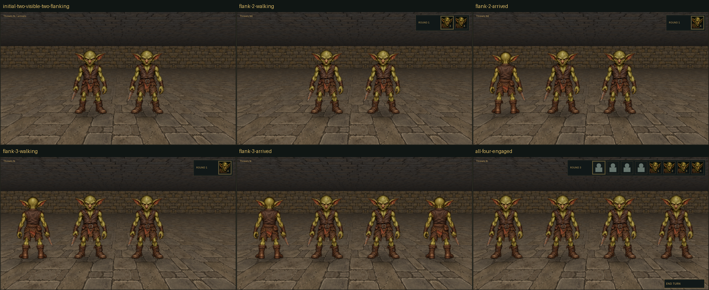

# Combat positioning review — 2026-11-03



One fixed-camera encounter starts with two goblins holding the central near-row
slots and two more offscreen on the flanks. The waiting goblins receive initiative
turns, walk into the free visible diagonal near-row slots and attack on later turns.
Both central goblins hold their positions throughout. The party remains facing north.

The six native 1920×1080 captures show the initial arrangement, halfway/arrival
samples for each flanker, and the final four-enemy fight:

- [Initial two visible enemies](initial-two-visible-two-flanking.png)
- [Left flanker walking](flank-2-walking.png) / [arrived](flank-2-arrived.png)
- [Right flanker walking](flank-3-walking.png) / [arrived](flank-3-arrived.png)
- [All four engaged, with both flankers' attacks in the log](all-four-engaged.png)

Native initial/final frames and all six overview panels were inspected. The
diagnostic asserts movement followed by attack participation for both flankers,
frontal attack eligibility, stable centre attackers and camera, four picked final
bodies, hidden-window state, no GL errors and complete world-resource release.
It passed on NVIDIA RTX 3060/OpenGL 3.3. Owned high-HP/no-damage mechanics keep the
encounter deterministic; goblin/world art is production, party identities are
intentional fixtures. No campaign is loaded or changed. Interactive review remains
user-owned; this is not a balance benchmark or cross-device pixel identity claim.

Reproduce in a new or empty output directory:

```sh
nice -n 15 ionice -c 3 cmake-build-release/blobber_world_integration_gpu_tests \
  cmake-build-release/assets NEW_OUTPUT --combat-positioning-review
```

Only application-owned hidden rendering, scripted session actions and screenshots
are used; no OS mouse/keyboard injection or focus control. The associated mechanical
coverage is recorded in [the design](../../combat_positioning.md).
`manifest.json` records the executed diagnostic and PNG SHA256 identities.
