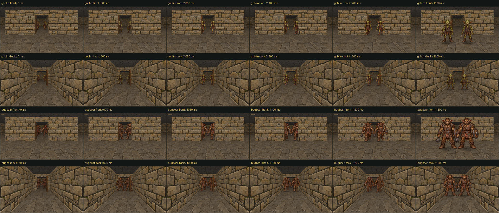

# Creature occlusion review — 2026-11-03



Twenty-four native 1920×1080 application-owned captures show pairs of production
goblins and bugbears approaching and crossing the same open Underkeep doorway.
`front` looks north from the open room; `back` looks south down the passage.
Each group contains samples at 0, 600, 1050, 1100, 1200 and 1600 ms. First they
enter the door cell (0–600); then they walk toward the camera (1000–1600).
The camera stays fixed within each group. Normal perspective changes screen size;
the diagnostic asserts unchanged authored world dimensions at every sample.

The jamb/open leaf obscure sides of bodies; the lintel obscures the larger
bugbears' heads until they pass it. Goblins retain matching scale through the
threshold. No creature gets smaller to clear geometry or moves sideways to fit.
All 24 samples were inspected in the overview, with native detail checks including
the front threshold at 1100 ms, the clear front at 1600 ms and the reverse doorway.

Representative native views:

- [Goblins at the threshold](goblin-front-1100.png)
- [Goblins clear of the doorway](goblin-front-1600.png)
- [Bugbears beneath the lintel](bugbear-front-1100.png)
- [Reverse view](goblin-back-600.png)

Reproduce in a new or empty output directory:

```sh
nice -n 15 ionice -c 3 cmake-build-release/blobber_world_integration_gpu_tests \
  cmake-build-release/assets NEW_OUTPUT --creature-occlusion-review
```

The diagnostic uses a hidden window, in-process actor motion and checked game door
commands. It checks creature dimensions, active intersection masks, GL errors and
resource release, without loading a campaign or sending desktop input. It passed
on NVIDIA RTX 3060/OpenGL 3.3. The separate generated-art GPU test checks exact
CPU/GPU interior ID agreement and visible object membership; the broader GPU
integration checks doors, effects, frame allocations and resource uploads.
Interactive acceptance remains user review; no cross-device pixel identity claim.

Logs for this run: `/tmp/creature-occlusion-{visibility-gpu,integration-gpu,review}.log`.
`manifest.json` records capture and diagnostic executable SHA256 identities.
