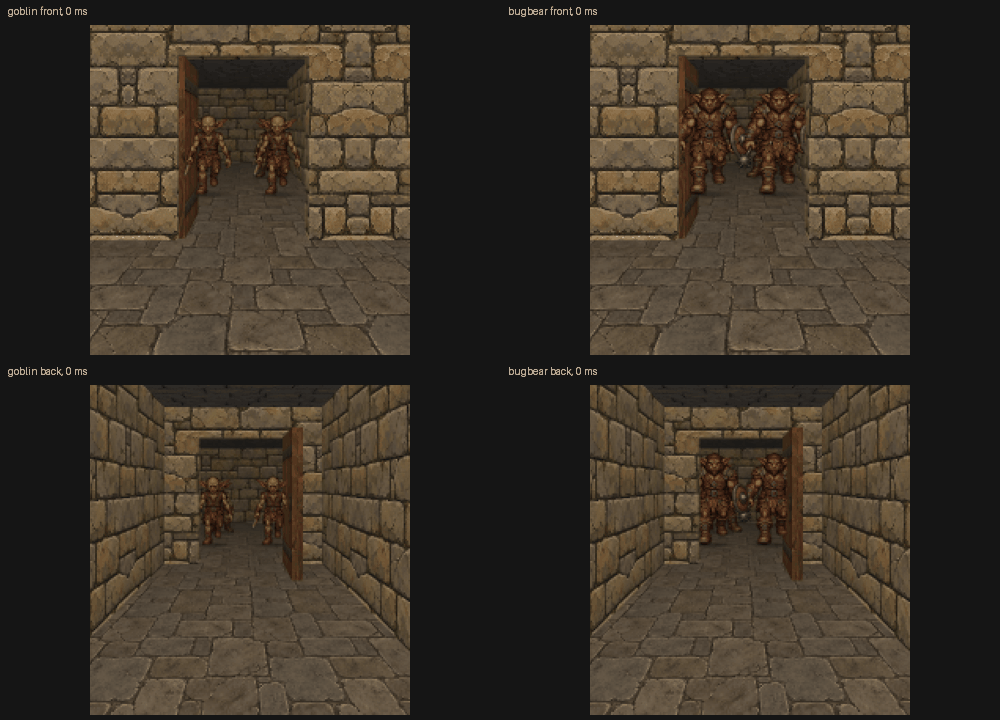

# Ground-anchored door review — 2026-11-04



The gallery uses two approaching creatures plus one rear creature. Creature size,
anchors, occupancy and movement are unchanged. A creature's relationship to an open
leaf comes from its ground anchor and the extended broad leaf slab; only the real
finite door silhouette can cover it. Walls/jambs/lintels still clip normally.
This convention removes both leaf-volume strips and the initial prototype's pop
when a billboard first touched the finite free tip.

Native close views:

- [Goblins, front](goblin-front-700.png) and [reverse](goblin-back-700.png).
- [Bugbears, front](bugbear-front-700.png) and [reverse](bugbear-back-700.png).

Dense sample sheets:

- [Goblin tip crossing](goblin-tip.jpg) and [exit](goblin-exit.jpg).
- [Bugbear tip crossing](bugbear-tip.jpg) and [exit](bugbear-exit.jpg).

The animation intentionally slows the samples for inspection; it is not real-time
playback. At 0–600 ms the pair enters the doorway, then at 1000–1600 ms it walks out
toward the fixed camera. The separate 700 ms captures use an adjacent close camera
and are omitted from the animation. Both walks are sampled more densely near the
leaf tip. Authored walk frames change pose discretely, and ordinary perspective
changes projected size. No scenery-dependent size or anchor adjustment occurs.

There were 76 native 1920x1080 hidden application-owned captures, retained under
`/tmp/blobber-leaf-stable`; this compact gallery preserves four native close views,
contact sheets and an animated overview. [Manifest](manifest.json) records hashes
for all native captures. The shown scenery reconstructs the reported arrangement;
it does not load the user's save. Both tip sheets, exit sheets and close views were
inspected. Interactive gameplay and user visual acceptance remain unverified.

Reproduce in a new or empty directory:

```sh
nice -n 15 ionice -c 3 cmake-build-release/blobber_world_integration_gpu_tests \
  cmake-build-release/assets NEW_OUTPUT --creature-occlusion-review
```

Requires current copied UI assets (`blobber_assets`) and prepared production art.
The diagnostic asserts unchanged dimensions, hidden-window state, GL errors and
resource release. No OS input, window selection or focus automation is used.
Final generated-art GPU checks additionally verify IDs, both-quality colour,
allocations, uploads and lifecycle; see [design and verification](../../creature_occlusion.md).
The final enum naming and framebuffer-allocation failure guard do not change these
captured pixels; the final diagnostic binaries were checked again afterward.
