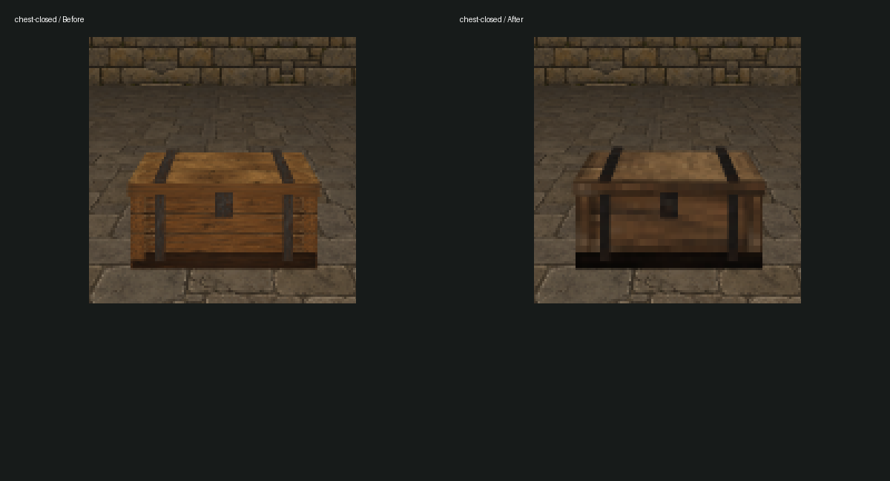
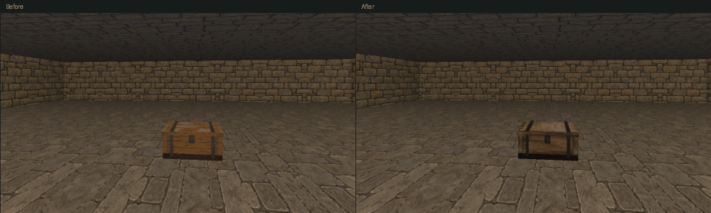
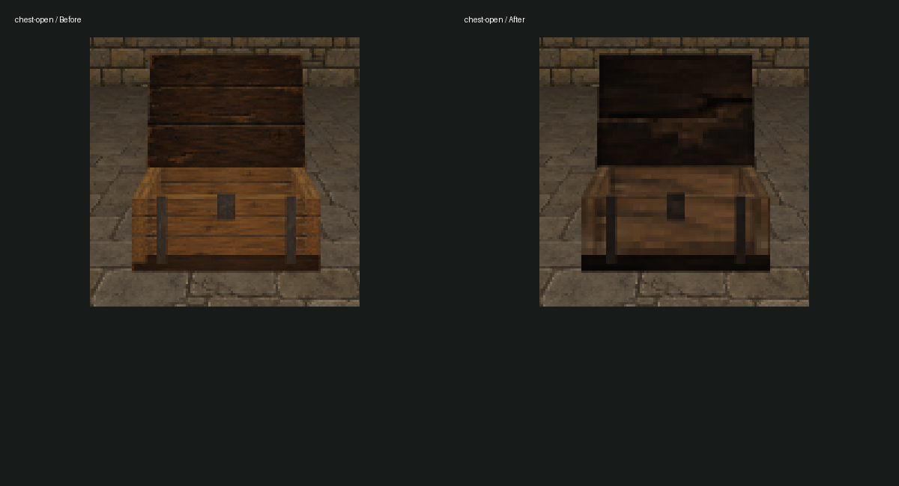
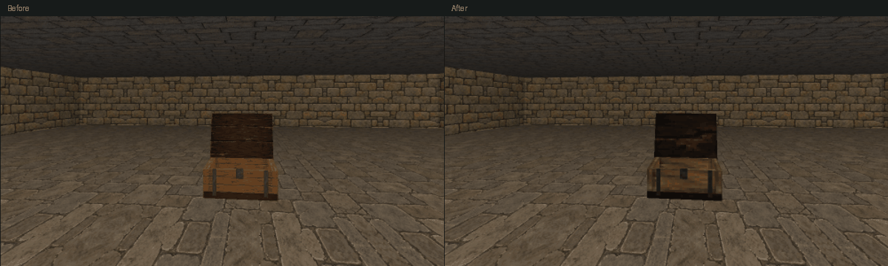
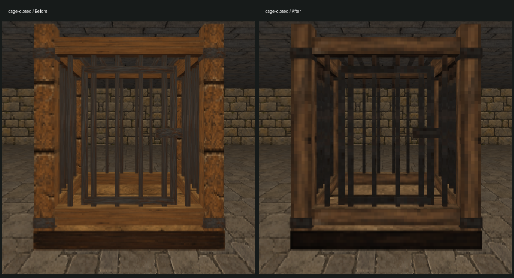
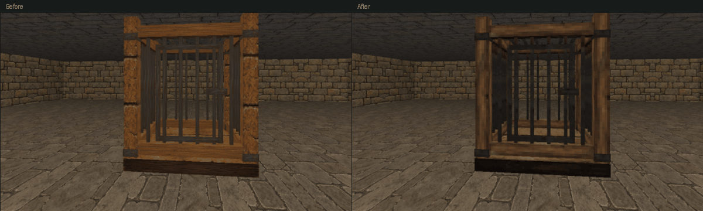
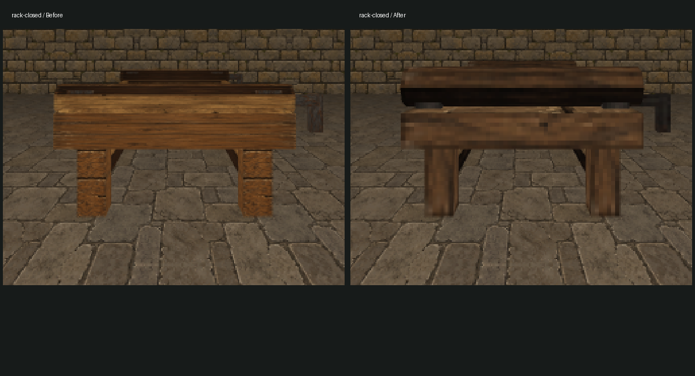
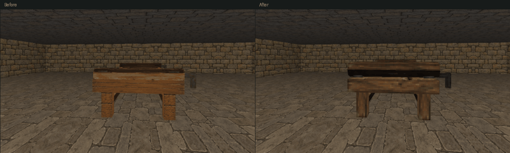

# Underkeep prop comparison

Actual game renderer, identical cameras and production assets. Left: before; right: revised. Close crops retain the approved half-size chest. Full captures are 1920×1080. Motion GIFs show five scripted turn samples slowed for review; they are not real-time recordings.

## chest-closed

## chest-open

## cage-closed

## rack-closed

## Full evidence

[All final game views](game-final-sheet.jpg) · [All Blender views](blender-final-sheet.jpg)

[Original game views](game-before-capture-sheet.jpg) · [Original Blender views](blender-before-sheet.jpg)

Four cardinal views, adjacent close view, and five turn samples per prop/state. Blender emission renders cover four oblique sides and the underside. No lamps or runtime lighting were added.

- [cage-closed-close](game-final/cage-closed-close.png)
- [cage-closed-motion-0](game-final/cage-closed-motion-0.png)
- [cage-closed-motion-1](game-final/cage-closed-motion-1.png)
- [cage-closed-motion-2](game-final/cage-closed-motion-2.png)
- [cage-closed-motion-3](game-final/cage-closed-motion-3.png)
- [cage-closed-motion-4](game-final/cage-closed-motion-4.png)
- [cage-closed-side-0](game-final/cage-closed-side-0.png)
- [cage-closed-side-1](game-final/cage-closed-side-1.png)
- [cage-closed-side-2](game-final/cage-closed-side-2.png)
- [cage-closed-side-3](game-final/cage-closed-side-3.png)
- [chest-closed-close](game-final/chest-closed-close.png)
- [chest-closed-motion-0](game-final/chest-closed-motion-0.png)
- [chest-closed-motion-1](game-final/chest-closed-motion-1.png)
- [chest-closed-motion-2](game-final/chest-closed-motion-2.png)
- [chest-closed-motion-3](game-final/chest-closed-motion-3.png)
- [chest-closed-motion-4](game-final/chest-closed-motion-4.png)
- [chest-closed-side-0](game-final/chest-closed-side-0.png)
- [chest-closed-side-1](game-final/chest-closed-side-1.png)
- [chest-closed-side-2](game-final/chest-closed-side-2.png)
- [chest-closed-side-3](game-final/chest-closed-side-3.png)
- [chest-open-close](game-final/chest-open-close.png)
- [chest-open-motion-0](game-final/chest-open-motion-0.png)
- [chest-open-motion-1](game-final/chest-open-motion-1.png)
- [chest-open-motion-2](game-final/chest-open-motion-2.png)
- [chest-open-motion-3](game-final/chest-open-motion-3.png)
- [chest-open-motion-4](game-final/chest-open-motion-4.png)
- [chest-open-side-0](game-final/chest-open-side-0.png)
- [chest-open-side-1](game-final/chest-open-side-1.png)
- [chest-open-side-2](game-final/chest-open-side-2.png)
- [chest-open-side-3](game-final/chest-open-side-3.png)
- [rack-closed-close](game-final/rack-closed-close.png)
- [rack-closed-motion-0](game-final/rack-closed-motion-0.png)
- [rack-closed-motion-1](game-final/rack-closed-motion-1.png)
- [rack-closed-motion-2](game-final/rack-closed-motion-2.png)
- [rack-closed-motion-3](game-final/rack-closed-motion-3.png)
- [rack-closed-motion-4](game-final/rack-closed-motion-4.png)
- [rack-closed-side-0](game-final/rack-closed-side-0.png)
- [rack-closed-side-1](game-final/rack-closed-side-1.png)
- [rack-closed-side-2](game-final/rack-closed-side-2.png)
- [rack-closed-side-3](game-final/rack-closed-side-3.png)
